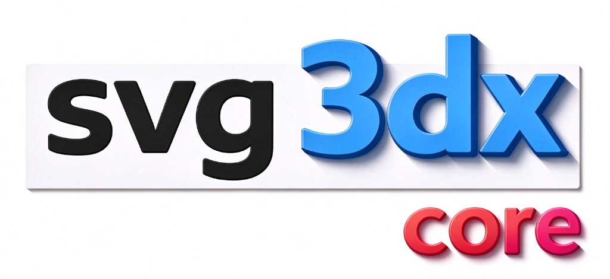

<p align="center">
  
</p>

# svg3dx-core

[中文](README.zh-CN.md) | English

Official **engine library** for svg3dx: parse and evaluate in Rust, then expose WASM / C ABI to viewer components, editors, and desktop hosts.

## Related libraries

| Repository | Role |
|------------|------|
| [svg3dx](https://github.com/xiaohunqupo/svg3dx) | Format specification and samples (`SVG3DX_ROOT`) |
| **svg3dx-core** (this repo) | Parse / evaluate + WASM + C ABI |
| [svg3dx-viewer](https://github.com/xiaohunqupo/svg3dx-viewer) | Embeddable **viewer component** |
| [svg3dx-studio](https://github.com/xiaohunqupo/svg3dx-studio) | **svg3dx editor** |

## Architecture

```
svg3dx-core (Rust)  →  geometry instruction sequence (JSON)
        │
   ┌────┴────┐
 WASM FFI   C ABI
```

No meshing, solid boolean kernels, or rendering — that belongs to the host (viewer / OCCT / etc.).

**Session API:** `DocumentSession` (WASM: `Svg3dxSession`, C: `svg3dx_session_*`) parses once, then re-evaluates after param patches, returning an `UpdateResult` with stable `node_id`s (full result + node-level diffs) so viewer / studio can update the scene locally.

## Repository layout

```
svg3dx-core/
├── assets/                # Logo and title artwork
├── crates/
│   ├── svg3dx-core/       # Parse and evaluate
│   ├── svg3dx-ffi-wasm/   # wasm-bindgen
│   └── svg3dx-ffi-c/      # C ABI → svg3dx_core.dll
├── cpp/                   # Headers + dump_json
├── pkg/                   # wasm-pack output (after build)
├── scripts/build-release.ps1
└── docs/
```

## Build

```powershell
.\scripts\build-release.ps1
```

Or manually:

```bash
cargo test -p svg3dx-core
cargo build -p svg3dx-ffi-c --release
wasm-pack build crates/svg3dx-ffi-wasm --target bundler --out-dir pkg --out-name svg3dx_ffi_wasm
cmake -S cpp -B cpp/build && cmake --build cpp/build
```

```powershell
.\cpp\build\Debug\dump_json.exe ..\svg3dx\samples\draft-0.1-example.svg3dx `
  --dll .\target\release\svg3dx_core.dll
```

## Multi-repo layout

See [docs/REPOS.md](docs/REPOS.md).

## License

MIT OR MulanPSL-2.0 (same as the format repo).
