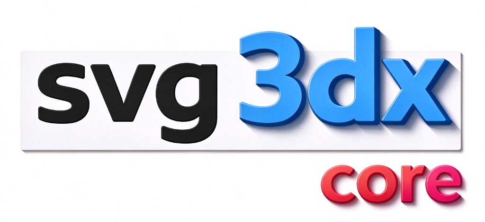

<p align="center">
  
</p>

# svg3dx-core

[English](README.md) | 中文

svg3dx 官方**引擎库**：在 Rust 中解析与求值，经 WASM / C ABI 供给查看器组件、编辑器与桌面宿主。

## 关联库

| 仓库 | 职责 |
|------|------|
| [svg3dx](https://github.com/xiaohunqupo/svg3dx) | 格式规范与 samples（`SVG3DX_ROOT`） |
| **svg3dx-core**（本仓） | 解析求值 + WASM + C ABI |
| [svg3dx-viewer](https://github.com/xiaohunqupo/svg3dx-viewer) | 可嵌入的**查看器组件** |
| [svg3dx-studio](https://github.com/xiaohunqupo/svg3dx-studio) | **svg3dx 编辑器** |

## 架构

```
svg3dx-core (Rust)  →  几何指令序列 (JSON)
        │
   ┌────┴────┐
 WASM FFI   C ABI
```

不做网格、布尔实体运算或渲染——那是宿主（viewer / OCCT 等）的职责。

**会话 API**：`DocumentSession`（WASM：`Svg3dxSession`，C：`svg3dx_session_*`）支持解析一次后改参重算，返回带稳定 `node_id` 的 `UpdateResult`（全量结果 + 节点 diff），供 viewer / studio 局部更新场景。

## 仓库结构

```
svg3dx-core/
├── assets/                # Logo 与标题图
├── crates/
│   ├── svg3dx-core/       # 解析与求值
│   ├── svg3dx-ffi-wasm/   # wasm-bindgen
│   └── svg3dx-ffi-c/      # C ABI → svg3dx_core.dll（含 cbindgen.toml）
├── cpp/                   # 自动生成的 svg3dx.h + dump_json
├── pkg/                   # wasm-pack 产出（构建后）
├── scripts/
│   ├── build-release.ps1
│   └── generate-c-header.ps1
└── docs/
```

## 构建

```powershell
.\scripts\build-release.ps1
```

流程：测试 → C DLL → **cbindgen 生成 `cpp/include/svg3dx.h`** → CMake `dump_json` → wasm-pack → `pkg/`。

或手动：

```bash
cargo test -p svg3dx-core
cargo build -p svg3dx-ffi-c --release
# 头文件: .\scripts\generate-c-header.ps1  或  ./scripts/generate-c-header.sh
wasm-pack build crates/svg3dx-ffi-wasm --target bundler --out-dir pkg --out-name svg3dx_ffi_wasm
cmake -S cpp -B cpp/build && cmake --build cpp/build
```

```powershell
.\cpp\build\Debug\dump_json.exe ..\svg3dx\samples\draft-0.1-example.svg3dx `
  --dll .\target\release\svg3dx_core.dll
```

## CI

GitHub Actions（`.github/workflows/ci.yml`）在 `main` / PR 上：

1. 检出并列仓 `svg3dx`（集成测试用 samples）
2. `cargo test` + release C ABI
3. `./scripts/generate-c-header.sh --check`（头文件漂移检查）
4. CMake `dump_json` 对官方示例冒烟
5. `wasm-pack` → `pkg/`
6. 上传 `pkg/`、`svg3dx.h`、`.so`、`dump_json`

## 多仓关系

详见 [docs/REPOS.md](docs/REPOS.md)。

## 许可证

MIT OR MulanPSL-2.0（与规范仓一致）。
